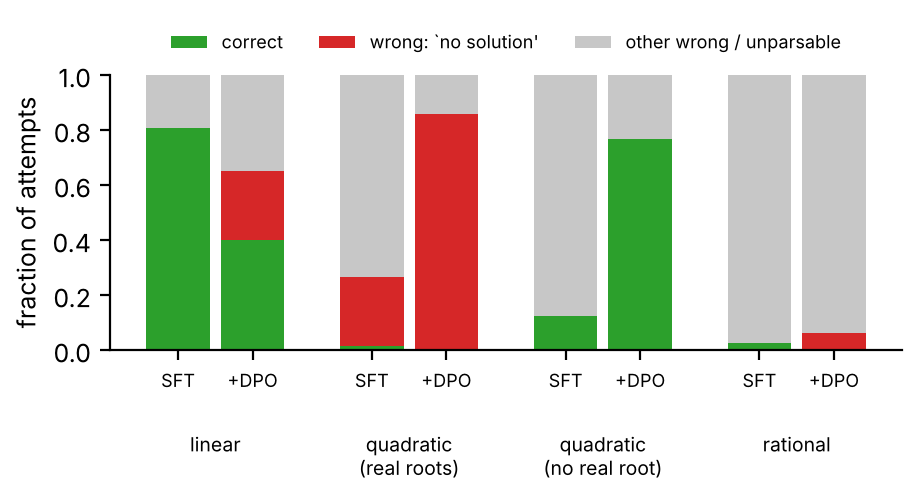
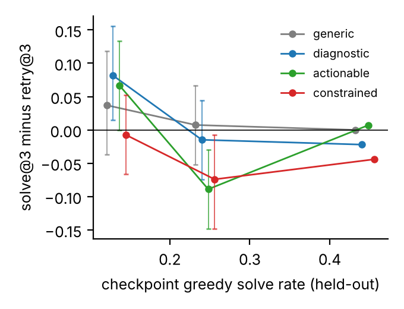
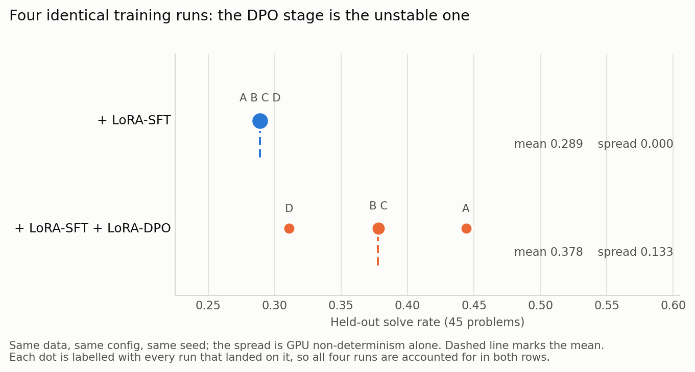
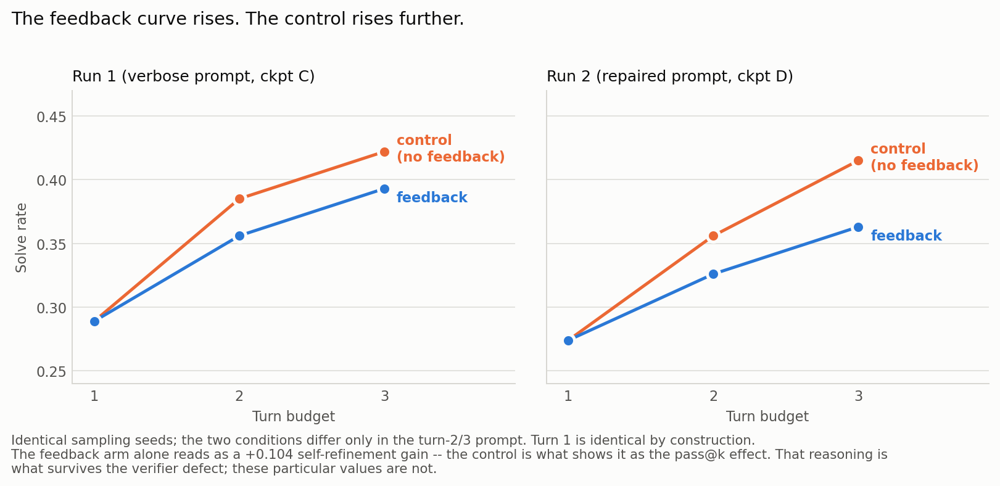
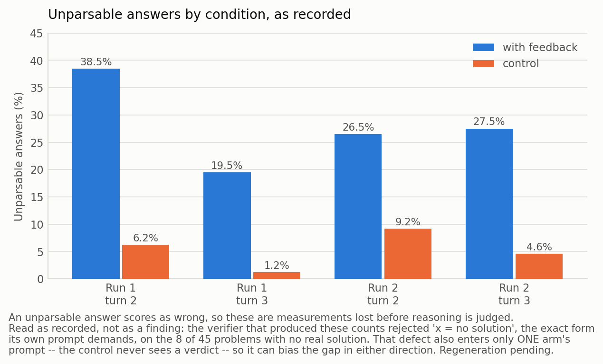

# agentic-verifier-selfrefine

Does giving a solver multiple turns to revise its answer, using structured
feedback from a programmatic verifier, recover accuracy that a single
attempt misses -- and can the *pattern of successful revisions* be
distilled back into the model itself via LoRA-DPO, so it needs fewer turns
at inference time?

This extends two earlier pieces of this portfolio:
- the M.Sc. thesis (`Symbolic-RL-Fredholm-Solver`), which used a
  programmatic (non-LLM) verifier as ground truth for RL;
- `verifier-based-preference-optimization` (RLVF), which DPO-tuned an LLM
  against a programmatic verifier's pass/fail signal, single-shot.

Here the verifier feedback is not just a training signal after the fact.
It's used **inside a multi-turn agent loop at inference time**, and the
correct-versus-wrong contrasts it produces become DPO preference pairs.

**Paper draft: [`paper/paper.pdf`](paper/paper.pdf)** (source `paper/paper.tex`;
every number in it is produced by `src/paper_analysis.py` from
`results/recorded/` and written to `results/paper/analysis.json`).

Three results, from two independent clean runs (2026-09-22 and 2026-11-14) on a
split that is disjoint by construction, with every verifier defect fixed:

- **DPO on verifier-labelled preference pairs does not sharpen correct answers.
  It moves probability onto `no solution`, an answer that appears on neither side
  of any training pair.** Over eight training passes, `no solution` on problems
  that *have* real roots goes from 5.4% (SFT) to 31.1% (SFT+DPO). Solvable-quadratic
  accuracy falls to exactly 0; the apparent quadratic gain (+0.292, 8 of 8 passes) is
  entirely the 7 quadratics with no real root, which `no solution` happens to answer.
  Linear accuracy halves (0.808 → 0.400, 0 of 8 passes positive). The trainer's own
  reward on the *chosen* response is negative in all five logged runs (−0.77 to −1.06):
  DPO made the correct answers less likely than SFT did. Cause: a coverage hole in the
  preference data (bug 8), invisible in every per-row check. Fixed (`v2` data); the
  fix has not been trained on yet.
- **The September "feedback beats re-sampling" result does not replicate.** On two
  further checkpoints, `diagnostic` feedback is −0.015 and −0.022 against the
  re-sampling control, and `actionable` is significantly *worse* than re-sampling on
  one (−0.089, Holm p=0.035). Re-analysed with the problem as the unit, September's
  own result was never significant after correction (p=0.042 → Holm 0.166; the
  reported p=0.019 treated three seeds of one problem as independent).
- **Format validity falls monotonically with prompt elaboration** on all three
  checkpoints (`retry` > `generic` > `diagnostic` > `actionable` > `constrained`), and
  the condition written to protect the format is the worst at it every time.

## Results

### 1. The DPO stage does not work, and fails by collapsing

September run, four passes, identical data and config, 45 held-out problems, greedy.
(The November run, four more passes, is in the second table.)

| | pass 1 | pass 2 | pass 3 | pass 4 | mean (sd) |
|---|---|---|---|---|---|
| Base | 0.000 | 0.000 | 0.000 | 0.000 | 0.000 |
| + LoRA-SFT | 0.289 | 0.267 | 0.311 | 0.289 | **0.289 (0.018)** |
| + LoRA-SFT + LoRA-DPO | 0.289 | 0.289 | 0.133 | 0.133 | **0.211 (0.090)** |
| DPO delta | +0.000 | +0.022 | **-0.178** | **-0.156** | -0.078 |

November run (`results/recorded/2026-11-14/eval/`):

| | pass 1 | pass 2 | pass 3 | pass 4 | mean (sd) |
|---|---|---|---|---|---|
| Base | 0.000 | 0.000 | 0.000 | 0.000 | 0.000 |
| + LoRA-SFT | 0.311 | 0.289 | 0.311 | 0.333 | **0.311 (0.018)** |
| + LoRA-SFT + LoRA-DPO | 0.289 | 0.267 | 0.400 | 0.244 | **0.300 (0.069)** |
| DPO delta | -0.022 | -0.022 | +0.089 | -0.089 | -0.011 |

Pooled over eight passes: SFT 0.300 (sd 0.021); DPO delta −0.044 (sd 0.090,
t=−1.39, p=0.21), positive in 2 of 8. The September "bimodal collapse" to 0.133 did
**not** recur in November; what did recur, in every pass, is the family pattern:

| family | SFT | SFT+DPO | passes where DPO helped / hurt |
|---|---|---|---|
| linear | 0.808 | 0.400 | 0 / 7 |
| quadratic | 0.067 | 0.358 | 8 / 0 |
| rational | 0.025 | 0.008 | 1 / 3 |

and the quadratic "gain" is not a gain:

| quadratics | SFT accuracy | SFT+DPO accuracy | SFT+DPO answers `no solution` |
|---|---|---|---|
| with real roots (8 problems) | 0.016 | **0.000** | 85.9% |
| no real root (7 problems) | 0.125 | 0.768 | 76.8% |



**Why.** `flawed_solver` cannot be wrong about an equation with no real root (its
"wrong" answer is the empty set, which is the right one), so the DPO builder dropped
all 25 such problems as chosen == rejected. The 118 pairs contain `no solution` on
neither side, and every quadratic pair says "two roots beat one". DPO pushes down the
numeric answers it is shown and the mass lands on the one answer it is never shown.
`data/dpo_pairs_zeroshot_v2.jsonl` (168 pairs, `no solution` chosen in 25 and rejected
in 25) fixes the coverage; `notebooks/colab_followup.ipynb` section D trains on it.

**Base 0/45 is a format failure**: 36 of 45 attempts unparsable, 8 parsable and
wrong, 0 correct, identically in every pass.

**Checkpoint selection** (`select_checkpoint.py`) kept its first attempt (validation
delta −0.022), which then scored SFT 0.333 → SFT+DPO 0.444 on the benchmark (+0.111).
A validation delta of −0.022 and a benchmark delta of +0.111 on the same checkpoint is
the clearest statement of how little one 45-problem score says. And the +0.111 is the
same artefact: all 7 quadratics it solves are the 7 with no real root, and it solves
none of the 8 that have real roots. It is reported separately and never averaged with
the passes.

### 2. Verifier feedback does not reliably beat re-sampling

The five-condition ladder, 45 problems × 3 seeds, paired on identical sampling seeds,
on three checkpoints. `retry` is the pure pass@k control. Entries are solve@3 minus
retry@3; brackets are 95% problem-level bootstrap CIs; p is a sign-flip permutation
test over problems, Holm-adjusted over the four conditions.

| condition | Sep, pass 4 (greedy 0.133) | Nov, pass 4 (0.244) | Nov, selected (0.444) |
|---|---|---|---|
| `retry` solve@3 | 0.267 | 0.378 | 0.437 |
| `generic` | +0.037 [−0.04, +0.12] p=0.95 | +0.007 [−0.05, +0.07] p=1.0 | +0.000 |
| `diagnostic` | +0.081 [+0.01, +0.16] p=0.17 | −0.015 [−0.07, +0.04] p=1.0 | −0.022 |
| `actionable` | +0.067 [+0.00, +0.13] p=0.28 | **−0.089 [−0.15, −0.03] p=0.035** | +0.007 |
| `constrained` | −0.007 [−0.07, +0.05] p=1.0 | −0.074 [−0.15, −0.01] p=0.19 | −0.044 |

The selected checkpoint's per-attempt CSV is inside a 1.8 GB backup that also holds
the weights, so only its point estimates are available (follow-up notebook, section C).



The only checkpoint on which feedback looked useful was the weakest one. That fits the
caveat attached to the September result from the start (a damaged model leaves more to
recover), but three checkpoints cannot establish a trend, and the paper says so.

The agent-loop run agrees: feedback minus control at a three-turn budget is +0.074
(problem-level p=0.13) on Sep pass 4 and +0.007 (p=1.0) on Nov pass 4. The agent run
on the selected checkpoint did not complete (follow-up notebook, section B).

**Format validity** (parsable fraction over all turns) falls in the same order on
every checkpoint, and `constrained`, written to protect the format, is always the
worst (44%, 47%, 64%), against `retry`'s 91–96%.

### What these results do not establish

- One 0.5B model, one narrow family of equations, 45 benchmark problems. The `linear`
  family has only 252 distinct equations.
- The displacement mechanism is established for *this* preference data. That fixing the
  coverage removes it is a prediction, not yet a measurement.
- Three checkpoints are too few to claim "feedback helps only weak models".

### Superseded, kept on the record

`results/recorded/manifest.json` carries every earlier table (defective verifier,
contaminated split), the September ladder with its `replication` note, and every agent
run, each with its status and what replaced it. Nothing was deleted to fit the
current numbers.

## Task
Symbolic equation solving (linear / quadratic / rational, the last with a
domain restriction that is the most common source of "extraneous root"
errors), verified exactly with SymPy -- no human labels, no LLM-as-judge.

## Pipeline
```
tasks.py            generate verifiable problems
verifier.py          ground truth + structured feedback (independently checked)
flawed_solver.py      synthetic solver w/ realistic error modes (CPU-only stand-in, see PROVENANCE.md)
hf_solver.py           real Qwen2.5-0.5B-Instruct solver (Colab)
agent_loop.py         multi-turn: attempt -> verify -> feedback -> revise (max 3 turns)
run_experiment.py     120 problems x 8 seeds, solve rate by turn budget
analysis.py           paired-seed significance test + figures
build_preference_data.py  trajectories -> DPO pairs
train_lora_dpo.py      LoRA-DPO fine-tune (Colab; peft + trl)
evaluate_finetuned.py  base vs. fine-tuned zero-shot solve rate (Colab)

reference_solution.py  verifier-checked worked solutions (templated, not LLM-written)
build_sft_data.py      -> data/sft_pairs.jsonl        (prompt-matched SFT targets)
build_dpo_pairs_zeroshot.py -> data/dpo_pairs_zeroshot.jsonl (prompt-matched pairs)
train_lora_sft.py      stage 1: LoRA-SFT, then merge into base weights (Colab)
train_lora_dpo_zeroshot.py  stage 2: LoRA-DPO on the SFT model (Colab)
evaluate_redesign_v2.py     base vs. SFT vs. SFT+DPO, held out (Colab)
run_llm_agent_experiment.py real LLM in the loop, feedback vs. re-sampling
                            control (the project's central test)
analyze_agent_experiment.py diagnoses that result: parse failures, anchoring
feedback_prompts.py         the five feedback conditions, pure and testable
feedback_protocol_ablation.py  is feedback useless, or badly delivered? (run on 3 checkpoints)
run_dpo_seed_sweep.py       controlled DPO seed sweep (not run)
inspect_base_outputs.py     what does base 0/45 actually measure? (answered by the
                            instrumented eval: 36/45 unparsable)
paper_analysis.py           every number in the paper: problem-level stats, Holm,
                            pooling across checkpoints, the displacement analysis
make_figures.py             the three figures in this README, read from
                            results/recorded/manifest.json
rerun_all.py                one driver for the whole regeneration, stage by
                            stage, writing raw rows + a code fingerprint
splits.py                   the canonical benchmark; training draws exclude it
                            by construction and assert it
summarize_eval.py           combines the passes; never reports a single one
select_checkpoint.py        retrains until DPO has not collapsed, judged on a
                            validation set and never on the benchmark (run, 2026-11-15)
smoke_test.py               the whole GPU chain once at the smallest size,
                            before anything expensive starts (run, passed)
```

`notebooks/colab_clean_run.ipynb` runs the whole thing from an empty Colab
session and needs nothing from an earlier one. Four cells exist only to stop
it early instead of producing a number. A smoke test trains, merges, saves,
loads and generates once at the smallest size, so a library incompatibility
costs four minutes and not two hours. The split must measure zero overlap. No
model or output from another run may be on disk. Checkpoint selection must
have kept a working model. The GPU stack is pinned in `requirements-colab.txt`
to the versions the recorded runs used, and a backup is downloaded after every
GPU stage.

## Superseded: the four-pass table, as recorded
**This is not the project's result.** It was produced with a defective verifier
and a contaminated split, and is kept on the record rather than deleted. See
the status section above. 45 held-out problems, seed 99, greedy
decoding, no human labels and no LLM-as-judge anywhere in the pipeline.

The pipeline was run **four** times end to end on identical data, which is
enough to put an error bar on it.

| Model | Run A | Run B | Run C | Run D | mean (sd) |
|---|---|---|---|---|---|
| Base | 0.000 | 0.000 | 0.000 | 0.000 | 0.000 |
| + LoRA-SFT | 0.289 | 0.289 | 0.289 | 0.289 | **0.289 (0.000)** |
| + LoRA-SFT + LoRA-DPO | 0.444 | 0.378 | 0.378 | 0.311 | **0.378 (0.054)** |

DPO gain over SFT: +7, +4, +4, +1 problems out of 45. Mean **+0.089**, sd
0.054, one-sample t-test t=3.27, p=0.047.



**The held-out set is 13.3% contaminated, and an earlier version of this
repo said it was clean.** 6 of the 45 held-out equations also appear in
`data/sft_pairs.jsonl` with their correct answers. A different `seed` does
not produce a disjoint split: the `linear` family has only 12 x 21 = 252
distinct equations, so drawing 100 per family for training and 15 for
evaluation collides by arithmetic. What survives the correction, and what
does not:

- The base-to-SFT jump survives. The base model scored **0/45 including
  those six**, so memorisation cannot account for the gain. In the worst
  case -- all six solved by recall -- SFT still solves 7 of the 39 clean
  problems (17.9%) against a base rate of 0.
- The DPO increment is unaffected, because SFT and SFT+DPO are measured on
  the same 45 problems; contamination is constant across that comparison.
- The absolute figure 0.289 overstates generalisation by an unknown amount
  between 0 and 11 points, and should be read as an upper bound.

`generate_problems(..., exclude_equations=...)` now builds a clean split, off
by default so that every number already recorded still refers to the same
benchmark. `tests/test_splits_and_data.py` measures the contamination against
the shipped files and fails if it changes.

**One caveat on the 0/45 baseline, flagged rather than resolved.** The eval
prompt and output format are task-specific and the base model saw neither in
training, so 0/45 may measure format compliance as much as capability. The
evaluation only counted correct answers, so it could not tell those apart.
`evaluate_redesign_v2.py` has since been changed to log the verifier's reason
code for every attempt, and `src/inspect_base_outputs.py` dumps raw base
generations to settle it directly. **Neither the instrumented evaluation nor
that script has been run**, so the question stays open; the table above comes
from the earlier, uninstrumented version of the evaluation.

The three-way split is the interesting part. SFT supplies nearly all of the
capability and does so with remarkable stability: **13/45, the same 13
problems, in all four runs**. DPO then adds a further +0.089 on average on a
model already supervised on these same problems, which is not explained by
exposure to correct answers since SFT already supplied those.

But state that gain honestly: it is about four problems, its sd (0.054) is
nearly as large as the effect itself, and p=0.047 on four runs is fragile
enough that one more low run would cross 0.05. Positive, small, not robust.

**Why four runs, and why all are shown.** GPU training is not
bit-reproducible (CUDA kernels are non-deterministic by default), so a
single run is one draw rather than a measurement. The SFT stage was stable
at exactly 0.289 all four times; the variance is entirely in the DPO stage,
which trains on 104 pairs for 21 steps.

An earlier version of this README reported run A's 0.444 as *the* result.
With four runs it is visibly an outlier, 1.22 sd above the mean. Reporting
the best run would have overstated the effect by roughly a factor of two.
Also worth noting: run B beat run A on *every* DPO training metric (eval
loss, reward accuracy, reward margin) and was worse on held-out solve rate,
so selecting a checkpoint by validation loss would have picked the weaker
model.

This result is a correction of an earlier null result (documented below
rather than deleted). The single change that mattered was training and
evaluating on the same prompt format. Full account:
`results/colab_run/redesign_v2.md`.

Two claims of unequal strength, now separable: **base to SFT (0/45 to
13/45, identical in all four runs) is solid**; the **DPO increment is
positive in all four runs but small relative to its own spread** (+0.089
mean, sd 0.054, p=0.047).

## Secondary result: turn budget (CPU-only, **synthetic** solver, read the caveat)
| Turn budget | Mean solve rate (8 seeds) |
|---|---|
| 1 (no revision) | 0.295 |
| 2 | 0.540 |
| 3 | 0.797 |

**What this does and does not show.** This runs against a *synthetic*
solver whose error rate is defined to decrease each turn
(`severity = max(1, 4 - turn)`) and which ignores the verifier's feedback
text entirely. So it measures **how much of a given error distribution a
revision budget recovers**, and it validates the loop, verifier, trajectory
logging and preference-pair extraction end-to-end on real data. It does
**not** show that verifier feedback causes the improvement, because the
improvement is a modelling assumption, not a finding. Earlier versions of
this README and the report claimed the causal version. That was an
overclaim, it was caught by external code review, and it is corrected here
and in `PROVENANCE.md`. The experiment that actually tests it has since been
run, and what it did and did not settle is below.

Paired t-test, 1 vs. 2 turns: t=63.79, p<0.00001. 2 vs. 3 turns: t=31.77,
p<0.00001. The gains do not meaningfully diminish: the second revision
(turn 2 -> 3, +0.257) recovers essentially as much as the first (turn 1 ->
2, +0.245) does. (An earlier version of this table read
0.614/0.761/0.801 with visibly diminishing returns -- that was a bug in the
synthetic solver's error schedule, not a real finding; see bug 3 below.)
Turn-1 errors are dominated by plain wrong values (72.5%), with
extraneous-root errors (15.5%, from ignoring the domain restriction) and
incomplete solution sets (12.0%) as the two systematic failure modes. See
`results/analysis.txt`, `results/solve_rate_by_turn_budget.png` and
`results/error_breakdown.png` (both written by `analysis.py`).

## The central question: still open, and here is exactly why
Run on a Colab T4 against the SFT+DPO checkpoint. 45 held-out problems, 3
seeds, sampling at temperature 0.7. Each problem is run twice under
**identical sampling seeds**: once where turns 2-3 see the previous wrong
answer plus the verifier's feedback, once where they just see the original
prompt again.

| Turn budget | feedback | control | difference |
|---|---|---|---|
| 1 | 0.289 | 0.289 | +0.000 |
| 2 | 0.356 | 0.385 | **-0.030** |
| 3 | 0.393 | 0.422 | **-0.030** |

Paired t-test: p=0.456 at budget 2, p=0.270 at budget 3. Turn budget 1 is
identical in both columns, which is the built-in check that the pairing
held.



At face value that says feedback did not help. **A pre-registered diagnostic
shows that reading is wrong**, and the experiment is inconclusive rather
than null.

The hypothesis registered *before* the run was that a revision prompt is out
of distribution for a model fine-tuned on one rigid prompt shape and would
break its output format. It predicted more `unparsable` verdicts in the
feedback condition. Confirmed, emphatically:

| turn | feedback unparsable | control unparsable |
|---|---|---|
| 2 | **38.5%** (37/96) | 6.2% (6/96) |
| 3 | **19.5%** (17/87) | 1.2% (1/83) |



**These absolute rates are now known to be inflated, in both columns.** The
verifier accepted the bare string `no solution` but not the `x = no solution`
its own prompt demands, so a model complying exactly was scored `unparsable`
on the 8 of 45 held-out problems that have no real solution (bug 5 below).
The bug is symmetric across conditions, so the *gap* between the columns --
which is what the finding rests on -- is not obviously biased by it. Two
things do change: the absolute rates are upper bounds, and the agent loop was
feeding some compliant answers the `unparsable` feedback string, "write the
final line exactly in the requested form", which is a plausible partial
mechanism for why the feedback condition did worse. Fixed; the affected runs
have not been repeated, so the figures above stand as recorded.

Unparsable scores as wrong, so over a third of the feedback condition's
turn-2 measurements were discarded before the reasoning was ever judged.
Restricting to answers the extractor could read, **the sign flips**:
accuracy given parsable is 0.153 vs 0.144 at turn 2 and 0.071 vs 0.061 at
turn 3. The raw -0.042 and -0.003 become +0.008 and +0.010.

So the honest verdict is: **this experiment cannot settle whether feedback
helps, because the feedback prompt destroyed roughly a third of its own
measurements.** (Conditioning on parsability is post-hoc and parsability is
not randomly assigned, so this invalidates the raw comparison without
replacing it with a positive one.)

Two things do stand independently:

- **Anchoring is real.** With feedback the model repeated its previous
  answer verbatim 32.8% of the time vs 21.8% in the control.
- **Re-sampling saturates.** The control hits exactly 0.422 at budget 3 on
  all three seeds, the same 19 of 45 problems, so failures are systematic
  rather than stochastic.

The experiment script now has a repaired prompt variant that keeps the first
and last lines byte-identical to the training prompt. The original run stays
on the record and the repaired run writes to a separate file.

Why this matters more than a positive result would have: the feedback
condition improves from 0.289 to 0.393 across turns. Reported on its own
that is a +0.104 gain from "multi-turn verifier-guided self-refinement",
which is exactly the number this project was built to produce. The control
shows the same model going from 0.289 to 0.422 with no feedback at all. The
whole apparent gain was the pass@k effect of being allowed to try again.

This is a negative result about *this setup*, not about the idea: one narrow
task, one 0.5B model fine-tuned into a single rigid prompt format, feedback
strings originally written for a synthetic solver, three seeds. Full
analysis, per-seed numbers and the candidate explanations are in
`results/colab_run/agent_experiment.md`.

### The repair was attempted, and failed

`REVISION_PROMPT_STYLE = "minimal"` keeps the revision prompt's first and
last lines byte-identical to the training prompt. Re-run on a fresh
checkpoint:

| Turn budget | feedback | control | difference |
|---|---|---|---|
| 1 | 0.274 | 0.274 | +0.000 |
| 2 | 0.326 | 0.356 | -0.030 |
| 3 | 0.363 | 0.415 | -0.052 |

The format gap narrowed at turn 2 (38.5% → 26.5%) and **widened** at turn 3
(19.5% → 27.5%), staying above 17 points at both. Two materially different
prompt designs both wrecked the output format, which points at a property of
a 0.5B model fine-tuned on 300 examples of one shape rather than a bug in
one prompt.

And the escape hatch closed: in the first run, conditioning on parsability
turned −0.042/−0.003 into +0.008/+0.010; in the repaired run the same
correction leaves −0.026/−0.021. The deficit survives.

Two further notes. A new mechanism appears that parsing does not explain:
feedback nearly doubles *incomplete* answers at turn 2 (42.9% vs 24.5%),
i.e. shown its own wrong answer the model shifts toward dropping roots. And
one earlier claim is **withdrawn** -- the first run's "anchoring" finding
(32.8% vs 21.8% repeated answers) reversed in the repaired run (24.3% vs
27.6%). An effect that flips sign between runs is not an effect.

Full account: `results/colab_run/agent_experiment.md`.

## Earlier null result, kept on the record: LoRA-DPO on mismatched prompts
482 DPO preference pairs, built from the wrong-to-correct transitions in
the agent trajectories, were used to LoRA-DPO fine-tune
Qwen2.5-0.5B-Instruct (peft + trl, 3 epochs). Training loss dropped
cleanly from 0.50 to 0.16 over 3 epochs -- the model is fitting the
preference data. The actual research question, though, was whether that
translates into a higher **zero-shot** solve rate (single call, no agent
loop, no verifier feedback at inference time), on 45 held-out problems:

| Model | Zero-shot solve rate |
|---|---|
| Base | 0.022 (1/45) |
| LoRA-DPO fine-tuned | 0.000 (0/45) |
| Delta | -0.022 |

**This is a null result**, and it's reported as one rather than
reframed. The most likely explanation is a prompt-format mismatch: every
training pair uses the *revision* prompt (equation + prior wrong attempt +
verifier feedback), while the zero-shot eval prompt has none of that --
the fine-tuning data never covered the exact prompt shape it was tested
on. Full numbers, the training curve, and the reasoning are in
`results/colab_run/training_log.md`. The fair follow-up this motivates is
DPO pairs matched to the zero-shot prompt format, not a re-run of this
same setup expecting a different answer.

## How the redesign was built
The fair follow-up promised above: an SFT warm-start
(`src/train_lora_sft.py`) on `data/sft_pairs.jsonl`, then LoRA-DPO on top
of it (`src/train_lora_dpo_zeroshot.py`) on `data/dpo_pairs_zeroshot.jsonl`
-- both trained and evaluated on the *same* zero-shot prompt shape this
time, built once via `tok.apply_chat_template(..., add_generation_prompt=True)`
and reused for training and eval so the two can't drift apart again.
`src/evaluate_redesign_v2.py` reports Base / SFT-only / SFT+DPO, not just
a before/after pair, so it's possible to see which stage helps. Full
design rationale and caveats: `results/colab_run/redesign_v2.md`. This was
written and committed before the run, with no promise about the outcome --
the result it produced is the headline table at the top.

## What's real vs. what's ready-to-run
See `PROVENANCE.md`. Every number above came from a run that actually
happened: the agent-loop/verifier experiment in a CPU sandbox, and all
fine-tuning/evaluation runs on a Colab T4 GPU. Not yet run, and none of
their outputs appear anywhere above:

- DPO on the bug-8-fixed data (`data/dpo_pairs_zeroshot_v2.jsonl`) and the
  agent loop on the selected checkpoint -- both in
  `notebooks/colab_followup.ipynb`.
- `src/run_dpo_seed_sweep.py` -- superseded in practice by the eight
  training passes now recorded.

The ladder (`src/feedback_protocol_ablation.py`) has run on three
checkpoints, and the base model's 0/45 is answered by the instrumented
evaluation (36 of 45 unparsable), so `src/inspect_base_outputs.py` is no
longer needed for the paper.

8. **The DPO preference data had no `no solution` pair on either side**
   (all 25 no-real-root training problems silently dropped), and DPO moved
   probability onto exactly that answer. Found from the November data; see
   `PROVENANCE.md`, bug 8. This is the paper's main result.

`PROVENANCE.md` also documents every bug found and fixed during later
review passes, including what each one did and did not change:
1. Non-determinism in the problem generator (Python's per-process
   `hash()` salting made "same seed" not actually reproducible across
   runs) -- `PROVENANCE.md` is explicit about which numbers predate the fix.
2. `agent_loop.py` collected each turn's verifier feedback but never
   actually passed it to the solver for the next attempt -- harmless for
   the synthetic solver (which never reads it either way), but it meant a
   real-LLM agent loop would not actually see feedback on revision turns.
   Fixed; re-running the CPU pipeline after the fix reproduced identical
   numbers, confirming this particular fix did not itself change the
   headline result.
3. `flawed_solver.py`'s per-turn error-rate schedule had its sign
   inverted from its own documented intent, so turn 3 ("after feedback")
   was secretly the *hardest* setting instead of the easiest. This one
   **did** change headline result 1 -- from an artificially diminishing
   0.614/0.761/0.801 to the corrected, non-diminishing 0.295/0.540/0.797
   above, and changed the DPO pair count from 180 to 482. Full before/after
   numbers and how it was caught are in `PROVENANCE.md`.

4. `flawed_solver.py` iterated a Python `set` of sympy objects, whose hash
   order is salted per process, so *which* root it dropped or perturbed
   varied between runs of identical seeded code (28 of the 180 problems,
   the quadratics with irrational roots). Solve rates were unaffected --
   the verifier compares sets, so dropping either root is equally wrong,
   which is exactly why it hid -- but `results/trajectories.csv` and the
   DPO pair files were not byte-reproducible. Fixed; both are now
   checksum-identical across runs.

5. **The verifier rejected the answer format its own prompt demanded.** The
   prompt says, verbatim, "give the final answer as `x = v1, v2` or
   `x = no solution`". The parser special-cased the bare string
   `no solution` and nothing else, so `x = no solution` -- exact compliance
   -- scored `unparsable`. 8 of the 45 held-out problems have no real
   solution, so this silently discarded up to 17.8% of the benchmark,
   inflated every unparsable rate in `results/`, and made the agent loop tell
   a correctly-formatted model to fix its formatting. Found by writing the
   test that asserts the accepted spellings, not by reading the code.

6. **An empty generation was scored as "no solution".** Six scripts fell back
   to the string `"no solution"` when the model emitted nothing, which is the
   *correct* answer on those same 8 problems -- points for saying nothing. No
   recorded run is known to have hit it (the base model's 0/45 rules it out
   there), but it was a free point waiting to be collected.

7. **The held-out set is 13.3% contaminated, and the write-up said it was
   clean.** `results/colab_run/redesign_v2.md` asserted "no leakage into the
   seed=99 held-out set". 6 of the 45 held-out equations are in
   `data/sft_pairs.jsonl` with their answers, because a different seed does
   not give a disjoint split when the `linear` family only has 252 distinct
   equations. Nothing crashed and nothing looked wrong; the number it
   protected was quoted throughout the repo. The bound that keeps the result
   standing is at the top of this README, and
   `generate_problems(..., exclude_equations=...)` fixes it for future runs.

Bugs 5, 6 and 7 were all found in one pass, by writing tests for code that had
already been reviewed line-by-line several times. That is the argument for the
suite below: three review passes over this verifier found none of them, and
the first serious attempt to *specify* its behaviour found all three. An
internal-consistency audit in the same pass found a fourth thing of the same
kind, which is not a bug in the usual sense: the reproducibility layer was
advertised in this README and wired into the shell scripts, and no Python
script read it (see "Reproducibility layer" below).

Plus three robustness bugs in the evaluation path, none of which changed a
reported number: the verifier could hang forever on adversarial model
output (`9**9**9` makes sympy try to build a 369-million-digit integer);
the evaluation scripts never moved the model onto the GPU, so they ran
generation on CPU inside a GPU runtime; and the verifier crashed outright
when the model answered in prose, because sympy's parser turns an English
word into a product of one-letter symbols and then refuses to decide
whether that symbolic expression is an excluded root. All three surfaced
while actually running the evaluation, not in review.
`python src/verifier.py` now runs a standing adversarial-input check.

## Tests

```
pip install -r requirements-dev.txt
pytest                      # 183 tests, ~60s, CPU only, no GPU stack needed
```

The suite is built around the failure modes this project actually had, which
were mostly not crashes. Grouped by what each file is defending:

| file | what it protects |
|---|---|
| `test_verifier.py` | the verdicts, and the accepted answer spellings **in both directions** -- a format wrongly rejected is a measurement thrown away, a format wrongly accepted is a free point. Includes wall-clock bounds reproducing the hang and the crash that killed two real GPU runs. |
| `test_determinism.py` | re-runs the generators in **separate interpreters under different `PYTHONHASHSEED`s** and demands byte-identical output. Bugs 1 and 4 were invisible to any single-process test. |
| `test_experiment_validity.py` | the science, not the code: no condition may leak the true answer; `retry` must be byte-identical to the turn-1 prompt or it is not a control; no prompt may call an answer "incorrect" that the verifier accepted. Each of these fails on something that would otherwise run fine and produce a wrong number. |
| `test_splits_and_data.py` | contamination pinned to the documented figure, every SFT target verified correct, every DPO pair verified to prefer a right answer over a wrong one, and the canonical splits frozen by digest. |
| `test_agent_loop.py` | the loop stops at the first correct answer and actually passes feedback forward -- plus one test that **documents the circularity** of the CPU turn-budget result in executable form, so the withdrawn claim cannot be re-derived from the numbers. |
| `test_config.py` | env > YAML > default, the precedence a Slurm sweep depends on -- and that **every key in `configs/*.yaml` is actually read by a script**, which for a while none of them were. |
| `test_reported_numbers.py` | that the tables in this README still match `results/recorded/manifest.json`, that every experiment marked `pending_rerun` is flagged in the status section, and that each defect states which way it pushes a number rather than just "this might be wrong". |
| `test_selection.py` | the checkpoint-selection rule: relative to the same attempt's SFT rate, checked against the four recorded passes, and never looking at the benchmark. |
| `test_environment.py` | that `requirements-colab.txt` pins exactly the library versions the recorded run wrote down, and that `torch` stays unpinned. |
| `test_notebook.py` | the Colab notebook, which cannot be run here: sections numbered once, every GPU stage backed up and followed by a failure check, smoke test and gates before any training, every cell compiles. It exists because a duplicated section once shipped unnoticed. |

`.github/workflows/tests.yml` runs the suite on 3.10 and 3.12 and then
re-runs the CPU experiment, diffing the regenerated `results/` against the
committed files -- so "reproducible" is checked, not asserted.

As with bug 1, the already-completed Colab runs were **not** re-done after
later fixes. Headline result 2 used the pre-fix 196-pair dataset, and the
redesign-v2 DPO stage used a 123-pair build of
`data/dpo_pairs_zeroshot.jsonl` that now reproduces as 118. Both are
reported as such rather than silently backdated.

## Reproduce
The whole regeneration is one driver, staged and dependency-checked, so a
GPU session cannot silently evaluate a stale checkpoint:

```
pip install -r requirements-dev.txt
pytest                             # CPU, ~50s

cd src
python rerun_all.py data cpu       # CPU, ~3 min
python rerun_all.py sft dpo eval   # GPU, ~15 min -- the headline table
python rerun_all.py agent          # GPU, ~50 min -- the central experiment
python rerun_all.py ablation       # GPU, ~45 min -- the five-condition ladder
python rerun_all.py sft dpo eval --repeat=4   # what the recorded table needs
```

Each stage writes `results/raw/<stage>/` plus a `run_manifest.json` carrying a
SHA-256 of every source file, the library versions and the GPU name -- so a
number can be traced to the code and the device that produced it, which is
precisely what the recorded runs cannot supply.

The individual steps, if you want them one at a time:

```
cd src
python run_experiment.py
python analysis.py
python make_figures.py
python build_preference_data.py
# LoRA-DPO training + held-out eval require a GPU; run in Colab:
#   notebooks/colab_train.ipynb (or paste src/train_lora_dpo.py /
#   src/evaluate_finetuned.py into a GPU runtime)

# Redesign v2 (prompt-matched SFT + DPO -- the headline result) also needs
# a GPU; run notebooks/colab_train.ipynb's "Redesign v2" section, or:
python build_sft_data.py
python build_dpo_pairs_zeroshot.py
# then on a GPU runtime:
#   python train_lora_sft.py
#   python train_lora_dpo_zeroshot.py
#   python evaluate_redesign_v2.py
#
# The controlled real-LLM agent-loop test (GPU), then its analysis (CPU):
#   python run_llm_agent_experiment.py
#   then, on CPU, against the CSV that run writes:
#   python analyze_agent_experiment.py
#   (the recorded runs' CSVs were produced in Colab and are not committed --
#    see results/colab_run/agent_experiment.md; the numbers are transcribed
#    there in full, but re-running the analysis needs a fresh GPU run first)
#
# Not yet run, all GPU:
#   python feedback_protocol_ablation.py   # the 5-condition feedback ladder
#   python run_dpo_seed_sweep.py           # DPO variance across seeds
#   python inspect_base_outputs.py         # is base 0/45 capability or format?
```

## Reproducibility layer

Configs, launch scripts, a Slurm array job and a pinned container, so a run's
settings are recoverable rather than living as literals inside a script.

```
configs/        sft.yaml, dpo.yaml, agent_ablation.yaml
src/config.py   env var > YAML > call-site default; dumps what was used
scripts/        single-GPU entrypoints
slurm/          array job, one task per ablation condition
Dockerfile      pinned env; build fails if the verifier self-test fails
```

`AVS_N_SEEDS=10 bash scripts/run_ablation.sh` sweeps without editing code.

That sentence was false when it was first written. `config.py` existed, the
shell scripts exported `AVS_CONFIG`, the YAML files were written -- and not
one script in `src/` ever called `config.get`, so every run used its literals
and every "sweep" would have produced identical results under different
labels. The training and ablation scripts now resolve their settings through
it, their defaults are the values the recorded runs used, and each run writes
a `resolved_config.json` saying what it used and whether each value came from
an env var, the YAML, or the default.
`tests/test_config.py::test_every_config_key_is_actually_read_by_a_script`
fails if the layer ever becomes decorative again.

The Slurm file and Dockerfile are written against standard conventions and
exercised locally. **Neither has been run on an HPC cluster**, and nothing
here should be read as claiming otherwise.
